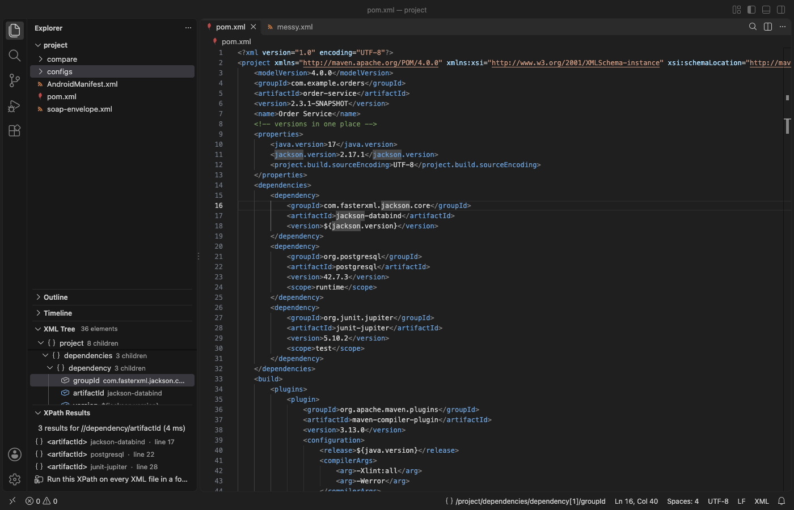

# XML Formatter & XPath Tools

XML formatter for VS Code that changes only the whitespace between tags, with XPath 1.0 on the file's own namespaces and a Copy XPath that selects the element under the cursor. Free, no sign-in, works offline.

Free:

- Format Document and Minify XML change only the whitespace between tags. Text, CDATA, comments, `xml:space="preserve"` and attribute values stay byte for byte, and a second format changes nothing.
- XPath 1.0 runs on the file's own prefixes, and plain names also match a default namespace, so `//dependency/artifactId` works in a `pom.xml`. Results list with line numbers; click one to jump to it.
- The status bar shows the XPath at the cursor. Click it to copy the path with positions, with id or name attributes, or in a portable `local-name()` form.
- Big files parse in a background thread. In the tests, a 49 MB file with about 1 million elements formatted in 1.6 seconds, and a 13.5 MB file on one line in 0.7 seconds, while the editor's thread never paused for more than 0.1 seconds.
- The XML Tree view in the Explorer follows the cursor, and Problems lists well-formedness errors with their line and column.

Zovo Pro: USD 19 once, for every Zovo extension. Three Pro tools, each with 3 free tries on your computer: Run XPath on every XML file in a folder (results as CSV, JSON or a Markdown report), Format all XML files in a folder, and Compare two XML files ignoring formatting and attribute order.

## Quick start

1. Install XML Formatter & XPath Tools.
2. Open an XML file and press Shift+Alt+F (Shift+Option+F on a Mac). If you have more than one XML formatter, VS Code asks which one to use.
3. Click the search button in the editor title to run an XPath, or click the XPath in the status bar to copy it.

"XML: Get Started" in the Command Palette opens a short tour with a sample file.

## Why this one

| Common problem | What this extension does |
|---|---|
| Formatting a large or single-line file never finishes, or blocks the editor | Formatting, the tree and XPath run in a worker thread, so the editor keeps working. Measured in `test/large.test.js` and `test/format.test.js`: 49 MB (1,049,601 elements) formatted in 1.6 s and indexed in 1.1 s; a 13.5 MB single-line file formatted in 0.7 s. Files over 50 MB, which VS Code does not pass to extensions, format on disk. |
| A copied XPath selects nothing, or Evaluate gives no output | The copied path is checked in the tests: for every sampled element in 22 files (11 samples and 11 real files such as an Apache `pom.xml`, a CycloneDX XSD, Android, XLIFF and .resx files), each of the 3 styles selects that one element and nothing else. XPath errors say what is wrong, for example which prefixes the file declares. |
| Formatting changes content: a space in `<t> </t>` is lost, `xml:space="preserve"` is ignored, spaces pile up before CDATA, comment indentation grows on every save | Text, CDATA, comments and preserved content are copied as they are. Each of those four cases is a test in `test/format.test.js`, and every sample file is formatted twice to check that the second run changes nothing. |
| A broken file gets no message, or Format inserts tags of its own | A file that is not well formed is never changed. Format shows the error with its line and column, and Problems lists it as you type. |

## Format and minify

- Format Document and Format Selection use the editor's tab size and spaces or tabs setting, and keep the file's line endings, its byte order mark and its final newline.
- Only whitespace between tags changes, in elements that hold tags and no text. An element with text in it, such as `
Some <b>bold</b> text
`, stays on its line as written.
- Attributes keep their values and quotes. With the default `keep` layout, a tag that already has one attribute per line keeps that layout; `oneLine` and `onePerLine` are the other choices.
- One empty line is kept where the file had empty lines between elements.
- "XML: Minify XML" removes the whitespace between tags in the file or the selection. Comments stay unless `xmlXpathTools.minify.removeComments` is on.
- Files over 50 MB: VS Code does not pass them to extensions. Right-click the file in the Explorer and pick "Format Large XML File on Disk". It writes `name.formatted.xml` next to it, or replaces the file after you confirm.

## XPath

- Click the search button in the editor title, or run "XML: Evaluate XPath". The last 20 expressions are kept per workspace.
- Prefixes come from the file: `//soap:Body/m:GetStockPrice`. When a prefix is not declared, the message lists the ones that are.
- Plain names also match elements in a default namespace (pom.xml, SVG, XAML, .csproj, KML). Turn on `xmlXpathTools.xpath.strictNamespaces` for strict XPath 1.0.
- Node results list in XPath Results with their line. Click to select the tag or attribute in the editor; right-click to copy the value or the node's XPath. Numbers, strings and booleans show on one line.

## Copy XPath

| Style | Example |
|---|---|
| With positions | `/project/dependencies/dependency[2]/artifactId` |
| With id or name attributes | `/manifest/application/activity[@android:name='.SettingsActivity']` |
| Portable | `/*[local-name()='project']/*[local-name()='dependencies']/*[local-name()='dependency'][2]` |

With the cursor on an attribute, the path ends in `/@name`. Positions count only siblings that the same name test matches, so the path selects one element. When a prefix is bound to two different namespaces in one file, the step uses `local-name()` and `namespace-uri()` instead.

## Safety

- No network code: the bundles load no HTTP or socket module, and a test checks it.
- Entities are never expanded and DTDs are never loaded. An entity bomb ("billion laughs") is measured, not expanded, and gets a warning; an external entity such as `file:///etc/passwd` is not read.
- Nothing changes your settings. Format runs only when you ask for it or when you turn on `editor.formatOnSave` yourself.

## Zovo Pro tools

Each tool has 3 free tries on this computer. A try counts only when the tool gives you a result; Escape, an XPath typo or a folder with no XML files uses none. After that, Zovo Pro (USD 19 once) turns them on in every Zovo extension. Find them in the Command Palette, in the Explorer right-click menu ("Zovo Pro: ..." on folders and XML files), and at the end of XPath Results.

- Run XPath on every XML file in a folder: one XPath, every `.xml`, `.xsd`, `.csproj`, `.svg`, `.kml` and similar file under a folder, each with its own namespace prefixes. The results open as CSV (file, line, kind, name, value) for a spreadsheet, as JSON for a script, or as a Markdown report for a review. XPath Results offers it for the expression you just ran.
- Format all XML files in a folder: the same safe formatter as Format Document checks every XML file, says how many would change, then formats them all (undo works in each file) or opens a Markdown report of what would change, for a review or a CI check. Files that are not well formed are listed and left alone.
- Compare two XML files ignoring formatting: indentation, line breaks, attribute order, quote style, `<a/>` versus `` and CDATA versus escaped text are ignored, so VS Code's diff shows only real changes in names, values, text and element order. Select two files in the Explorer, or compare the open file with another one.

## Settings

| Setting | Default | What it does |
|---|---|---|
| `xmlXpathTools.format.attributes` | `keep` | `keep`, `oneLine` or `onePerLine` |
| `xmlXpathTools.format.keepBlankLines` | `true` | Keep one empty line between elements |
| `xmlXpathTools.minify.removeComments` | `false` | Minify also removes comments |
| `xmlXpathTools.xpath.strictNamespaces` | `false` | Strict XPath 1.0 names |
| `xmlXpathTools.xpath.maxResults` | `5000` | Most results listed |
| `xmlXpathTools.copyXPathStyle` | `indexed` | `indexed`, `predicates` or `portable` |
| `xmlXpathTools.statusBar.showXPath` | `true` | XPath at the cursor in the status bar |
| `xmlXpathTools.tree.syncWithCursor` | `true` | The tree follows the cursor |
| `xmlXpathTools.validate` | `true` | Well-formedness errors in Problems |
| `xmlXpathTools.maxFileMB` | `60` | Largest file for the tree, XPath and checks |
| `xmlXpathTools.showProTools` | `true` | The Zovo Pro line in XPath Results and the Explorer menu |

## Limits

- XPath 1.0 only. There is no XPath 2.0 or 3.1, XQuery or XSLT.
- It checks that a file is well formed. It does not validate against an XSD or a DTD.
- Files over 50 MB can be formatted on disk, but VS Code does not give them to extensions, so the tree and XPath do not run on them.
- The on-disk command reads UTF-8, UTF-16 with a byte order mark and ISO-8859-1.

## Support Zovo

Zovo Pro: USD 19 once, every Zovo viewer. [Get Zovo Pro on GitHub Sponsors](https://github.com/sponsors/theluckystrike/sponsorships?tier_id=679878) to turn on the Pro tools in this extension and in the other Zovo extensions you use. The free features stay free.

Zovo extensions have no ads and no tracking. They are made by [theluckystrike](https://github.com/theluckystrike) on GitHub. You can also support the work with no Pro:

- [Sponsor on GitHub](https://github.com/sponsors/theluckystrike)
- [PayPal](https://www.paypal.com/paypalme/najzzz)
- [Follow theluckystrike on GitHub](https://github.com/theluckystrike)

### Need your format supported?

Open a [format request](https://github.com/theluckystrike/xml-xpath-tools-vscode/issues/new?template=format-request.yml) with a sample file, and I reply there whether it can be done. For USD 299 once, through [this GitHub Sponsors tier](https://github.com/sponsors/theluckystrike/sponsorships?tier_id=679995), I add your file format or a missing feature to this extension, with tests, within 7 days.

## More tools by Zovo

- [PDF Viewer & PDF Reader to Read and View PDF (Dark Mode)](https://marketplace.visualstudio.com/items?itemName=zovo.pdf-viewer-dark) reads PDFs with a real dark mode, search, an outline and thumbnails.
- [XLSX Viewer, Excel Viewer, CSV Viewer & Parquet Viewer (XLS, CSV Preview)](https://marketplace.visualstudio.com/items?itemName=zovo.table-viewer-vscode) opens CSV, TSV, Excel and Parquet files as a sortable, filterable table.
- [DOCX Viewer & ODT Viewer, Word Document Preview (Dark Mode)](https://marketplace.visualstudio.com/items?itemName=zovo.docx-viewer-vscode) previews Word and ODT files with dark mode, an outline and search.

See [all Zovo extensions on the Marketplace](https://marketplace.visualstudio.com/publishers/zovo).
